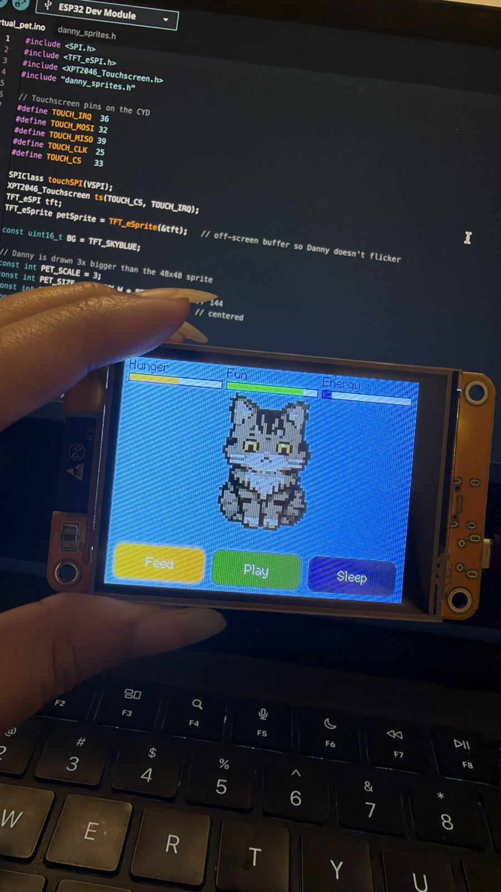

# Virtual Pet

A pocket virtual pet that reacts to light, touch, and motion. Built in C++ on an ESP32 with a custom 3D-printed shell.

The pet is Danny, a fluffy tabby cat drawn in pixel art.

Work in progress. The display, touch controls, and basic pet logic are working, and Danny is on screen. Right now I'm drawing his sprites for the rest of his moods.

## Progress

### Danny on screen

Replaced the placeholder circle with Danny's pixel-art sprite. Only his neutral face is finished so far, so the other moods still use it for now.

### Stats, moods, and touch buttons

Danny has hunger, fun, and energy stats that drop over time. You can feed him, play with him, or put him to sleep using the buttons on the touchscreen, and his mood changes based on his stats.

https://github.com/user-attachments/assets/03c6d61e-519e-468a-8375-0ab2ed8aa140

### First working display

## Hardware

- ESP32-2432S028R (the "Cheap Yellow Display")
- MPU-6050 accelerometer
- PCF8574 I/O expander
- 12x12mm tactile buttons
- 8 ohm speaker
- 3.7V LiPo battery, TP4056 charger, MT3608 boost converter

## Setup

Built with the Arduino IDE using the ESP32 board package, the TFT_eSPI library for the display, and the XPT2046_Touchscreen library for touch.

## To do

- [x] Get the display working
- [x] Touch input
- [x] Pet stats and moods
- [ ] Draw sprites for every mood
- [ ] Sleep mode using the light sensor
- [ ] Buttons and shake to play
- [ ] Sound
- [ ] Battery power
- [ ] Case
