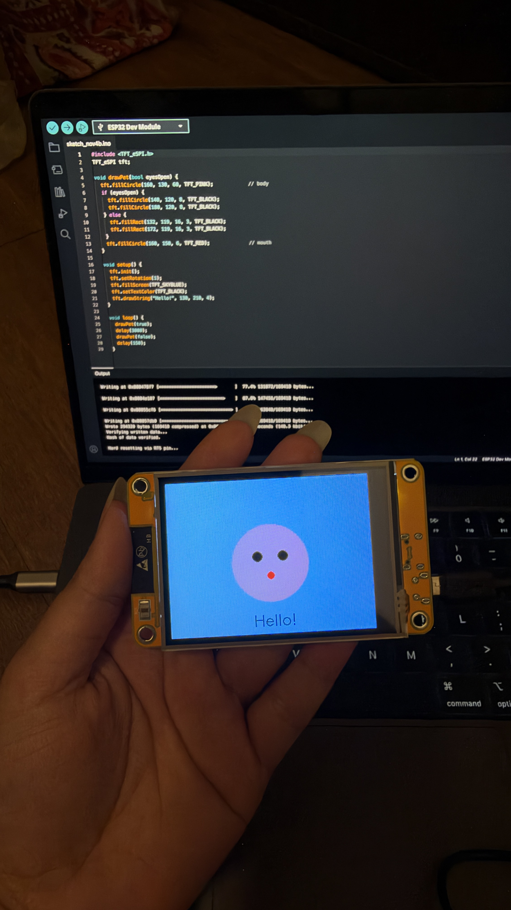

# Virtual Pet

A pocket virtual pet that reacts to light, touch, and motion. Built in C++ on an ESP32 with a custom 3D-printed shell.

Work in progress. Right now I'm getting the display running and building the basic pet logic.

## Hardware

- ESP32-2432S028R (the "Cheap Yellow Display")
- MPU-6050 accelerometer
- PCF8574 I/O expander
- 12x12mm tactile buttons
- 8 ohm speaker
- 3.7V LiPo battery, TP4056 charger, MT3608 boost converter

## Setup

Built with the Arduino IDE using the ESP32 board package and the TFT_eSPI library.

## To do

- [ ] Get the display working
- [ ] Pet stats and moods
- [ ] Draw sprites
- [ ] Sleep mode using the light sensor
- [ ] Buttons and shake to play
- [ ] Sound
- [ ] Battery power
- [ ] Case
